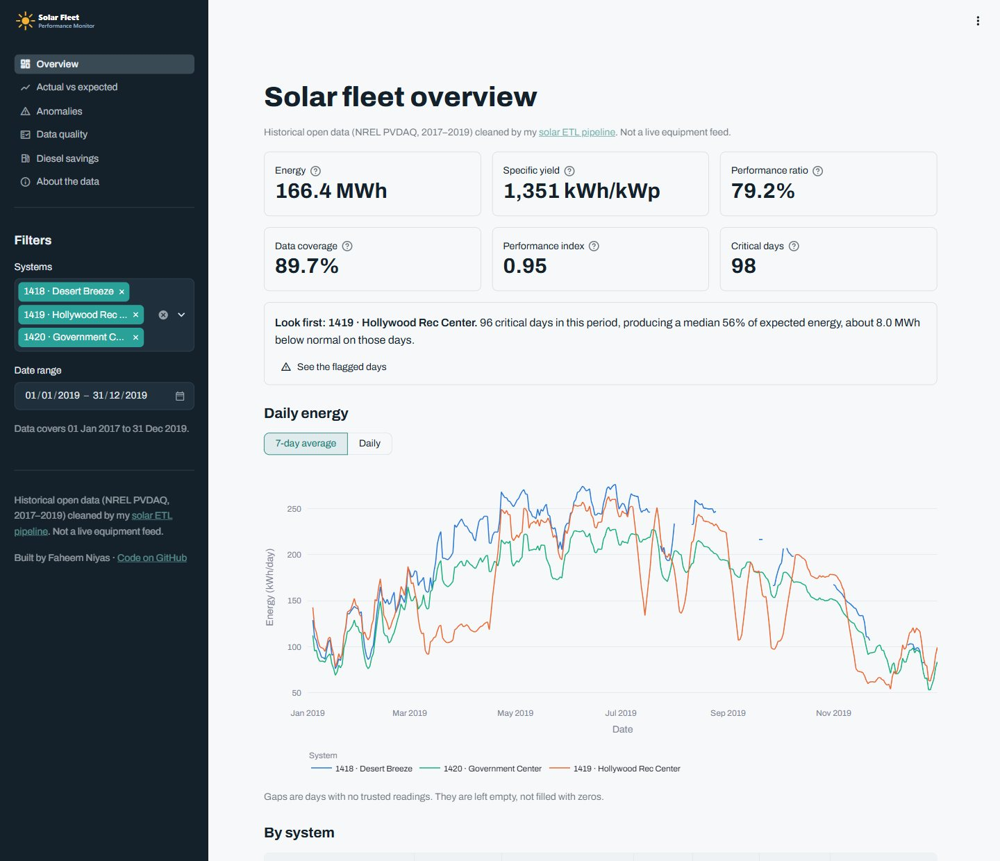
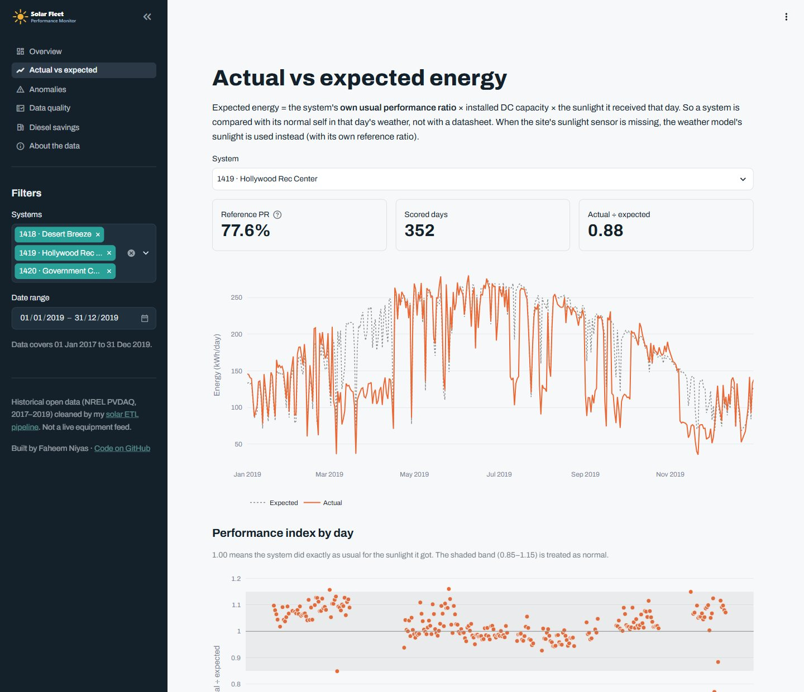
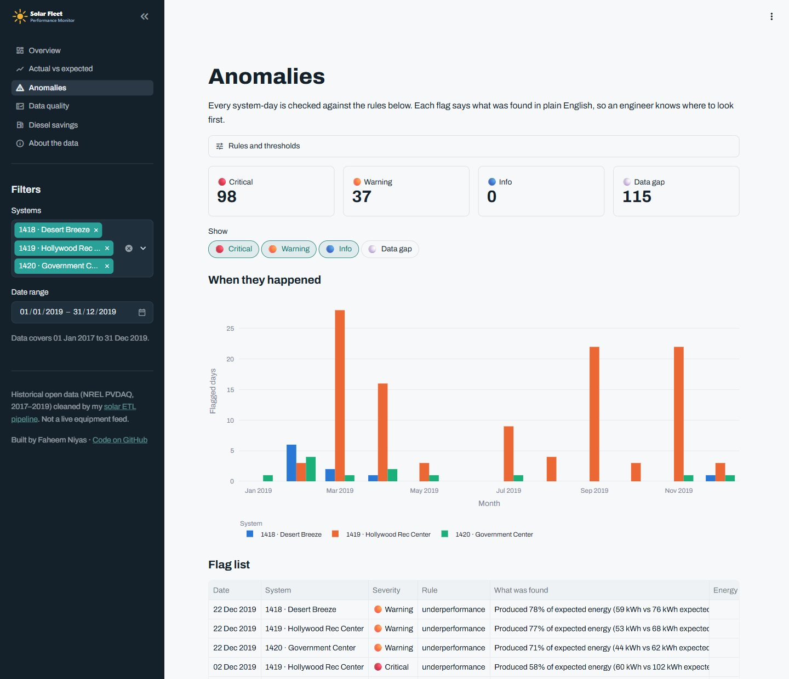
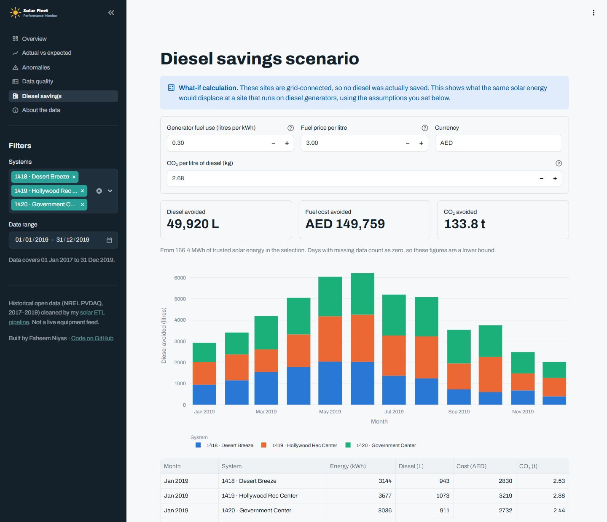

# Solar Fleet Performance Monitor

[](https://github.com/Hakkrax/solar-ops-dashboard/actions/workflows/tests.yml)
[](https://faheem-solar-ops.streamlit.app)


A Streamlit dashboard that answers the question an operations engineer asks every
morning: **is each solar system producing what the weather says it should, and if
not, where do I look first?**

**[Open the live app](https://faheem-solar-ops.streamlit.app)** (free hosting: if it has been idle,
click "wake up" and give it about 30 seconds).



## Highlights

- **It found a real fault.** System 1419 was flagged on 137 critical days. The raw
  monitoring files show one of its two inverters at 0 W at midday on those days while the
  other ran normally: a single-inverter outage caught from system totals alone.
- **Expected energy from each system's own history**, not a datasheet, so the comparison
  holds for any site with a sunlight sensor.
- **Six anomaly rules**, each with a plain-English reason and thresholds you can change
  on the page, including a robust z-score (median and MAD) for drops fixed limits miss.
- **Honest data handling:** gaps stay gaps, unscored days are labelled, and every
  definition is on the About page.
- **Tested:** 31 pytest tests cover the analytics, every rule on hand-made days with
  known answers, and a smoke test that renders every page. CI runs on every push.

| | |
|---|---|
| **Data** | Historical open data (NREL PVDAQ, 2017–2019) for three rooftop systems in Las Vegas, cleaned by my [solar ETL pipeline](https://github.com/Hakkrax/solar-etl-pipeline). It is **not** a live equipment feed. |
| **Stack** | Python 3.12, Streamlit, Plotly, pandas, SQLite, pytest, ruff, GitHub Actions |
| **Hosting** | Streamlit Community Cloud, deployed from `main` |

<table>
<tr>
<td></td>
<td></td>
</tr>
<tr>
<td align="center">Actual vs expected for system 1419</td>
<td align="center">Anomalies with a reason for every flag</td>
</tr>
</table>

## What it does

| Page | What you get |
|---|---|
| **Overview** | Energy, specific yield, performance ratio, data coverage, performance index and critical days for any date range and set of systems; daily or 7-day energy chart; per-system table; CSV export |
| **Actual vs expected** | Each system's daily energy against what it normally makes in that day's sunlight, plus a performance-index chart and an energy-vs-sunlight scatter |
| **Anomalies** | Every system-day checked against six rules, each with a plain-English reason and adjustable thresholds; monthly chart; filterable list; CSV export |
| **Data quality** | Monthly daylight coverage heatmap and counts of every data-quality rule the ETL applied |
| **Diesel savings** | What-if: the diesel, cost and CO₂ the same solar energy would displace at a generator-powered site, with your own assumptions |
| **About the data** | Sources, definitions and known limits |

## How "expected" is calculated

A system is compared with **its own normal behaviour**, not a datasheet:

```
expected energy  = reference PR × DC capacity × sunlight on the panels that day
reference PR     = the system's median daily PR over all scorable days
performance index = actual ÷ expected      (1.00 = a normal day for that system)
```

Only hours with both energy and sunlight readings count, so a missing sensor hour
doesn't drag the ratio down. When the site's sunlight sensor is missing for a day,
the weather model's sunlight is used with its own reference ratio, and the page
says which basis was used. Days with under 80% daylight data coverage, or very little
sunlight, are not scored.

## Anomaly rules

| Rule | Severity | Fires when |
|---|---|---|
| `underperformance` | critical / warning | performance index below 0.60 / 0.85 |
| `over_performance` | warning | index above 1.15, which usually means the sunlight sensor reads low |
| `statistical_drop` | info | index inside the normal band but far below the previous 30 scored days (robust z-score below −3.5, using median and MAD) |
| `sensor_mismatch` | warning | on a sunny day the site's sunlight sensor disagrees with the weather model by more than 40% |
| `low_coverage` / `no_data` | data gap | too few trusted hours to judge the day |

All thresholds can be changed on the Anomalies page.

**What it found (2017–2019, default thresholds):** system 1419 has 137 critical days in
clusters (Aug 2017, Mar–Apr 2019, Sep and Nov 2019), producing a median of 54% of
expected energy. 1419 has two inverters, so I checked the raw PVDAQ files: on sample
flagged days one inverter reads 0 W at midday while the other runs normally (inverter 2
on 15 Aug 2017; inverter 1 on 20 Mar and 12 Nov 2019). The dashboard caught a
single-inverter outage from the system totals alone. Systems 1418 and 1420 have 1 and 2
critical days.

## Diesel scenario

The sites are grid-connected, so **no diesel was actually saved**. The page shows what
the same energy would displace at a diesel-powered site:

```
litres = energy (kWh) × generator fuel use (L/kWh, default 0.30)
cost   = litres × fuel price (default 3.00 AED/L; set your own)
CO₂    = litres × 2.68 kg/L
```

Missing days count as zero, so results are a lower bound.



## Run it

```bash
python -m venv .venv
```

```bash
.venv/bin/pip install -r requirements.txt -r requirements-dev.txt
```

On Windows use `.venv\Scripts\pip`. Then:

```bash
streamlit run app.py
```

```bash
pytest -q
```

31 tests: the analytics and every anomaly rule on hand-made days with known answers,
the diesel maths, data-file validation, and a smoke test that renders every page with
Streamlit's `AppTest`.

## Data

`data/solar_fleet.db` (11.8 MB SQLite) is built from the
[solar-etl-pipeline](https://github.com/Hakkrax/solar-etl-pipeline) output:

```bash
python scripts/build_data.py path/to/solar.db
```

It holds 78,840 hourly rows (3 systems × 2017–2019) joined with weather, the ETL's
data-quality counts and the source run ID. Totals match the pipeline's backfill
report (497.9 MWh).

## Project layout

```
app.py               navigation, sidebar filters, data loading
views/               one file per page
solar_ops/
  analytics.py       daily metrics, expected energy, anomaly rules, KPIs
  diesel.py          diesel-displacement maths
  data.py            loads and validates the SQLite file
  ui.py              shared Streamlit helpers, colours, formatting
assets/              logo and icon
scripts/build_data.py
tests/
```

## Known limits

- PR is indicative: DC capacity comes from PVDAQ's module list.
- System 1420's sunlight sensor reads lower relative to the weather model than the
  other sites, which may explain why its PR is higher.
- Anomaly flags are prompts to investigate, not proof of a fault.

## Credits

- NREL PV Data Acquisition (PVDAQ) via the Open Energy Data Initiative, CC BY 4.0.
  https://doi.org/10.25984/1846021
- Open-Meteo historical weather API, CC BY 4.0.

MIT licence for the code. The data is not covered by the code licence.

## Part of a three-project portfolio

1. [Retail sales and customer analytics](https://github.com/Hakkrax/retail-bi-analytics): Python cleaning, SQL star schema and a Tableau dashboard
2. [Solar PV ETL pipeline](https://github.com/Hakkrax/solar-etl-pipeline): the tested pipeline that produces this app's data
3. **Solar fleet performance monitor** (this repository)
